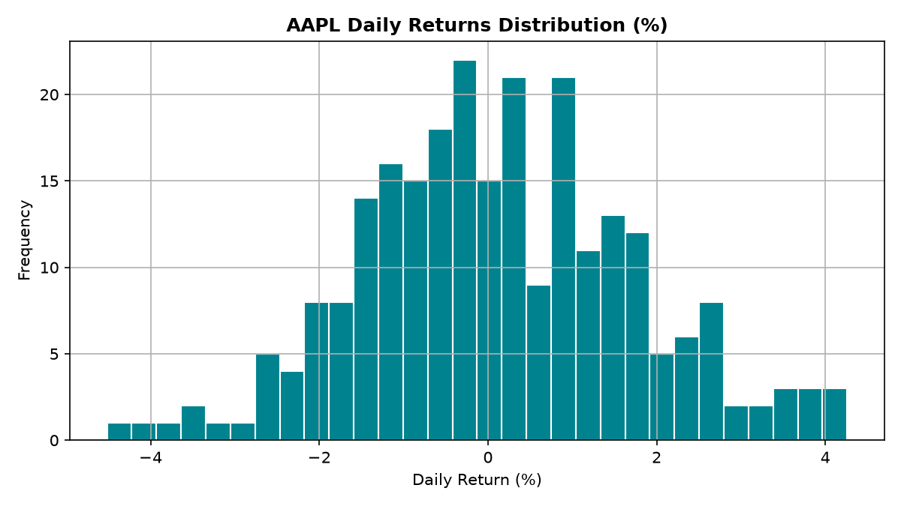

# Stock Market Data Analyzer

A Python financial data pipeline that ingests OHLCV candles (via `yfinance` or offline simulation), stores time-series in SQLite, computes technical indicators (SMA20, SMA50, RSI14, MACD, Bollinger Bands), runs a vectorized SMA crossover backtest with transaction fees, and serves charts via FastAPI and Matplotlib.

> **Disclaimer:** This project is for educational and portfolio demonstration purposes only and does not constitute financial advice.

## Setup & How to Run
```bash
python -m venv venv
source venv/bin/activate
pip install -r requirements.txt
python main.py
python -m unittest discover -s tests -v
```

## Generated Charts


