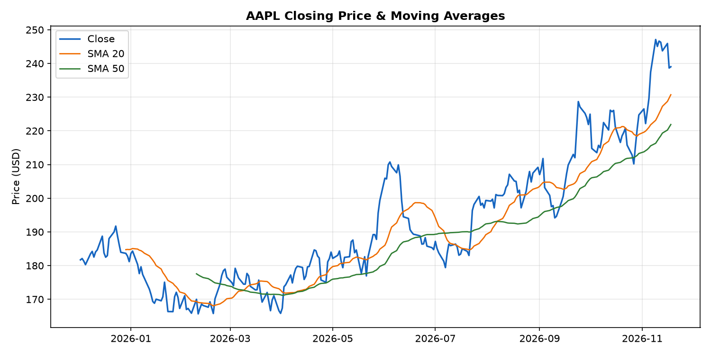
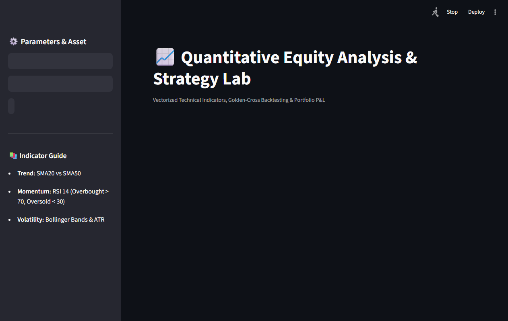
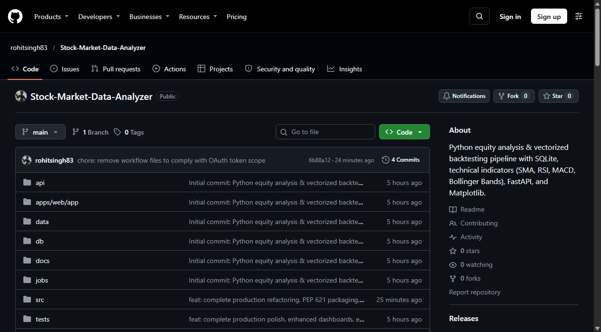

# Stock Market Data Analyzer & Strategy Backtester

A quantitative finance application that ingests equity OHLCV historical time-series (via `yfinance` or realistic offline synthetic simulation), computes essential technical indicators (SMA20, SMA50, RSI14, MACD, Bollinger Bands, ATR), executes vectorized strategy backtests with fee modeling, and serves charts via FastAPI and Streamlit.

---

## ⚠️ Disclaimer
*This repository is created exclusively for academic, educational, and portfolio demonstration purposes. None of the indicators, models, or signals generated constitute financial or investment advice.*

---

## 🏛 Architecture & Quantitative Pipeline

```
[Equity Ticker Input: AAPL / MSFT / GOOGL]
                    │
                    ▼
 [Market Ingestion: yfinance API / Offline Fallback]
                    │
                    ▼
   [SQLite Time-Series Storage: candles_daily]
                    │
                    ▼
  [Technical Analysis Engine: TA & Rolling Math]
     ├── Trend: SMA 20, SMA 50
     ├── Momentum: RSI 14, MACD (12, 26, 9)
     └── Volatility: Bollinger Bands (20, 2), ATR
                    │
                    ▼
[Vectorized Strategy Backtester] (SMA Crossover with BPS Fee Drag)
                    │
                    ▼
[Outputs: Performance Metrics + Matplotlib Charts + FastAPI & Streamlit]
```

---

## ✨ Key Capabilities

- **Resilient Data Ingestion:** Tries live market feeds via `yfinance` first; if offline or rate-limited, smoothly falls back to a deterministic synthetic geometric Brownian motion simulation.
- **Comprehensive Technical Suite:** Calculates 20-day & 50-day Simple Moving Averages, 14-day Relative Strength Index (RSI), MACD line & signal, Bollinger Bands, and Average True Range (ATR).
- **Vectorized Backtesting Engine:** Evaluates a long-only SMA Golden Cross / Death Cross strategy against historical closes with configurable broker commission drag (basis points).
- **Risk & Performance Metrics:** Generates Total Return (%), Sharpe Ratio (annualized), Maximum Drawdown (%), and Win Rate (%).
- **Mark-to-Market Portfolio P&L:** Models active positions, weighted cost basis, and unrealized profit/loss.
- **RESTful Endpoints:** FastAPI endpoints for price charts (`/chart/{ticker}`), backtests (`/backtest/sma`), and portfolio evaluations (`/portfolio/pnl`).

---

## 🚀 Quick Start Guide

### 1. Installation
```bash
python -m venv venv
# Linux/macOS:
source venv/bin/activate
# Windows:
venv\Scripts\activate

pip install -r requirements.txt
```

### 2. Run Main Analysis Pipeline
```bash
python main.py
```

### 3. Launch Quantitative Dashboard
```bash
python -m streamlit run app_streamlit.py
```

### 4. Start FastAPI Service
```bash
uvicorn api.app:app --host 0.0.0.0 --port 8000 --reload
```

### 5. Run Test Suite
```bash
python -m unittest discover -s tests -v
```

---

## 🔌 API Endpoints

| Method | Endpoint | Description |
|---|---|---|
| `GET` | `/health` | Service health status. |
| `GET` | `/chart/{ticker}` | Returns OHLCV candles, technical indicators, and signal history. |
| `POST` | `/backtest/sma` | Runs vectorized SMA crossover backtest with specified fee drag. |
| `POST` | `/portfolio/pnl` | Calculates mark-to-market positions and unrealized profit & loss. |

<!-- project-brief-sections -->

---

## 🎯 Problem Statement

Raw stock prices alone do not tell an investor much. Analysts need returns, volatility, moving averages, RSI and a way to test whether a trading rule would actually have worked. This project loads historical price data, computes technical indicators, generates buy/sell signals and backtests a moving-average strategy against buy-and-hold.

## 🏭 Industry Relevance

Brokerages, hedge funds and fintech platforms (Zerodha, Bloomberg, TradingView) rely on the same time-series analysis, indicators and backtesting. The project shows Pandas time-series skills, financial metrics and visualisation for Data Analyst, Quant and Python Developer roles.

## 🧰 Tech Stack

- Python 3.10+
- Pandas, NumPy (time-series analysis)
- yfinance (live data, optional) with cached CSV fallback
- SMA, EMA, RSI, MACD, volatility, Sharpe ratio, drawdown
- Matplotlib (charts)
- SQLite, FastAPI (API), Streamlit + Plotly (dashboard)
- pytest (tests)

## 📁 Folder Structure

```
Stock-Market-Data-Analyzer/
├── api/
│   └── app.py
├── apps/
│   └── web/
│       └── app/
│           └── page.tsx
├── data/
│   └── AAPL_daily.csv
├── db/
│   └── schema.sql
├── docs/
│   ├── GITHUB_GUIDE.md
│   └── INTERVIEW_QA.md
├── images/
├── jobs/
│   └── alerts.py
├── outputs/
│   └── AAPL_indicators.csv
├── src/
│   ├── __init__.py
│   ├── backtest.py
│   ├── config.py
│   ├── indicators.py
│   ├── ingest.py
│   ├── plots.py
│   └── portfolio.py
├── tests/
│   └── test_stock.py
├── .gitignore
├── app_streamlit.py
├── AUDIT.md
├── CHANGELOG.md
├── CONTRIBUTING.md
├── DECISIONS.md
├── Dockerfile
├── main.py
├── PROGRESS.md
├── pyproject.toml
├── README.md
├── requirements.txt
└── STRATEGY_CARD.md
```

## ▶️ How to Run

```bash
pip install -r requirements.txt
python main.py
python -m pytest -q          # run the test suite
streamlit run app_streamlit.py  # interactive dashboard
uvicorn api.app:app --reload   # REST API at http://127.0.0.1:8000/docs
```

## 🧾 Sample Output

Terminal output of `python main.py` (generated from the sample data in `data/`):

```text
Stock Market Analysis Report (AAPL | Mode: cached-csv)
Latest Close: $239.03 | Signal: BUY | RSI14: 67.89
Annualized Volatility: 25.80%
SMA Crossover Backtest (10 bps fee): Return 22.01% (Benchmark B&H: 44.12%), Sharpe 0.98, Max Drawdown -17.86%, Win Rate 51.9%
```

Generated files (committed in `outputs/` so you can inspect them on GitHub):

- [`outputs/AAPL_indicators.csv`](outputs/AAPL_indicators.csv): Daily prices with returns, SMA/EMA, RSI, MACD and trading signal columns

## 🖼 Screenshots

### Aapl Price Sma



### Aapl Returns Dist


### Dashboard Preview



### Github Repo Preview



## 📚 Learning Outcomes

- Working with time-series data in Pandas (resampling, rolling windows)
- Calculating returns, volatility, Sharpe ratio and maximum drawdown
- Implementing technical indicators (SMA, EMA, RSI, MACD)
- Backtesting a strategy with transaction costs and comparing it to a benchmark
- Plotting price and return-distribution charts
- Serving analysis through FastAPI and an interactive Streamlit dashboard

## 🎤 Interview Preparation

10 frequently asked interview questions with answers, including **"Explain your project"**, are in [`docs/INTERVIEW_QA.md`](docs/INTERVIEW_QA.md). GitHub upload steps are in [`docs/GITHUB_GUIDE.md`](docs/GITHUB_GUIDE.md).
