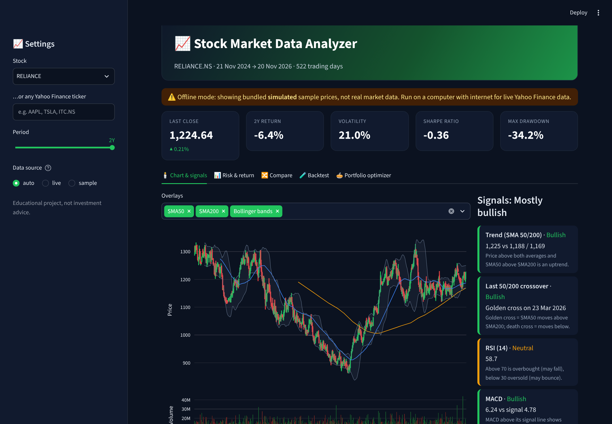
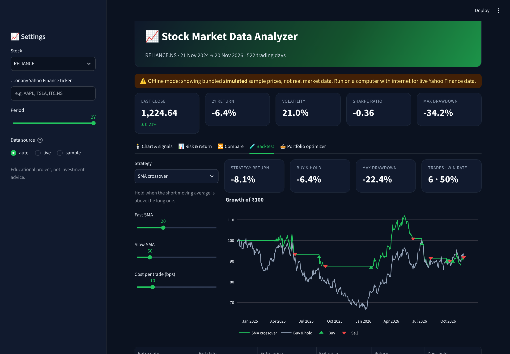
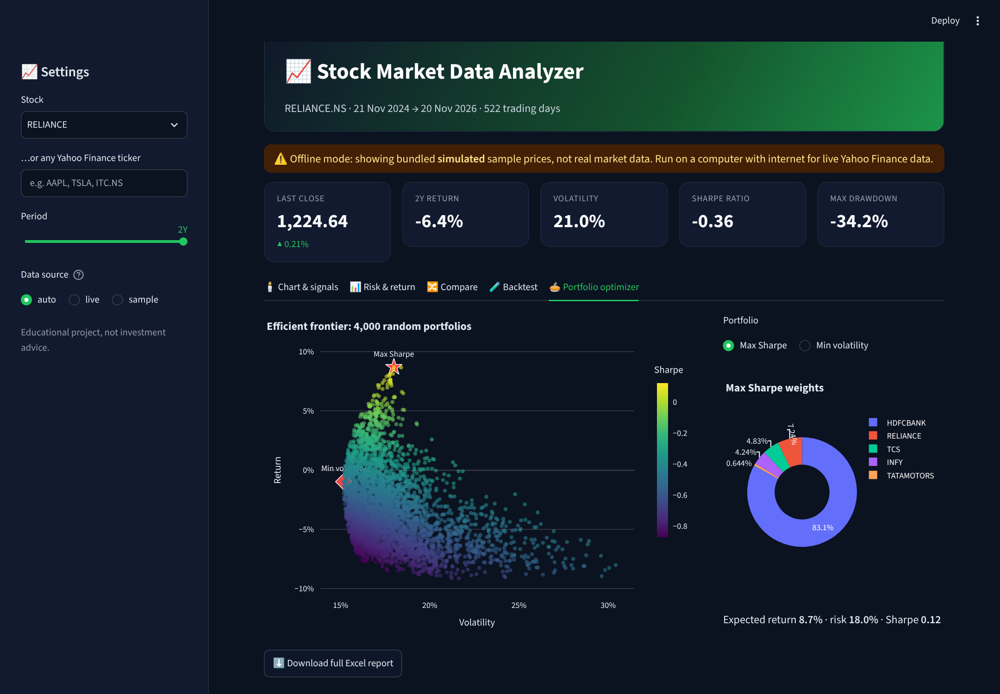
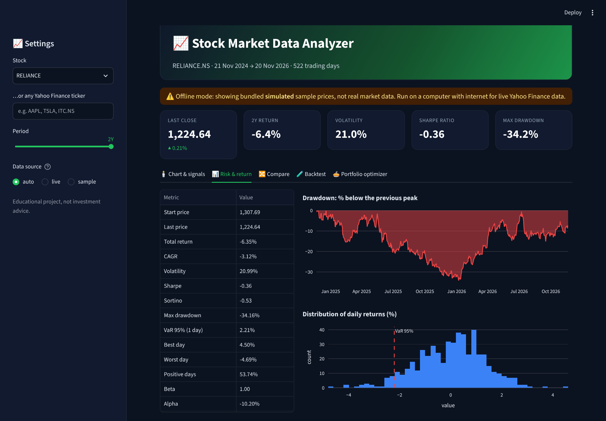
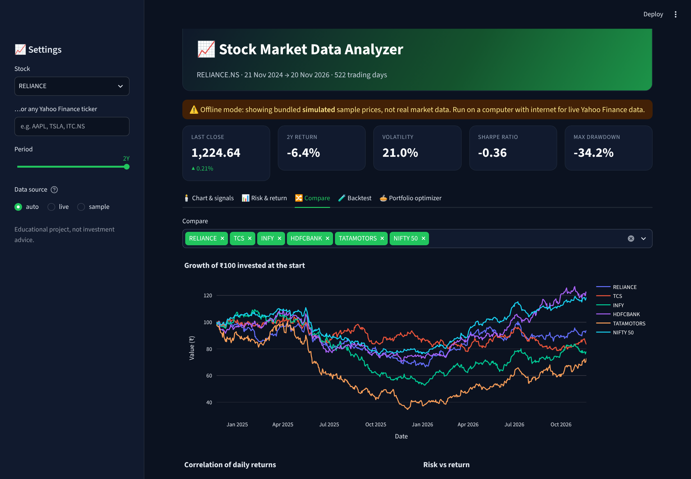
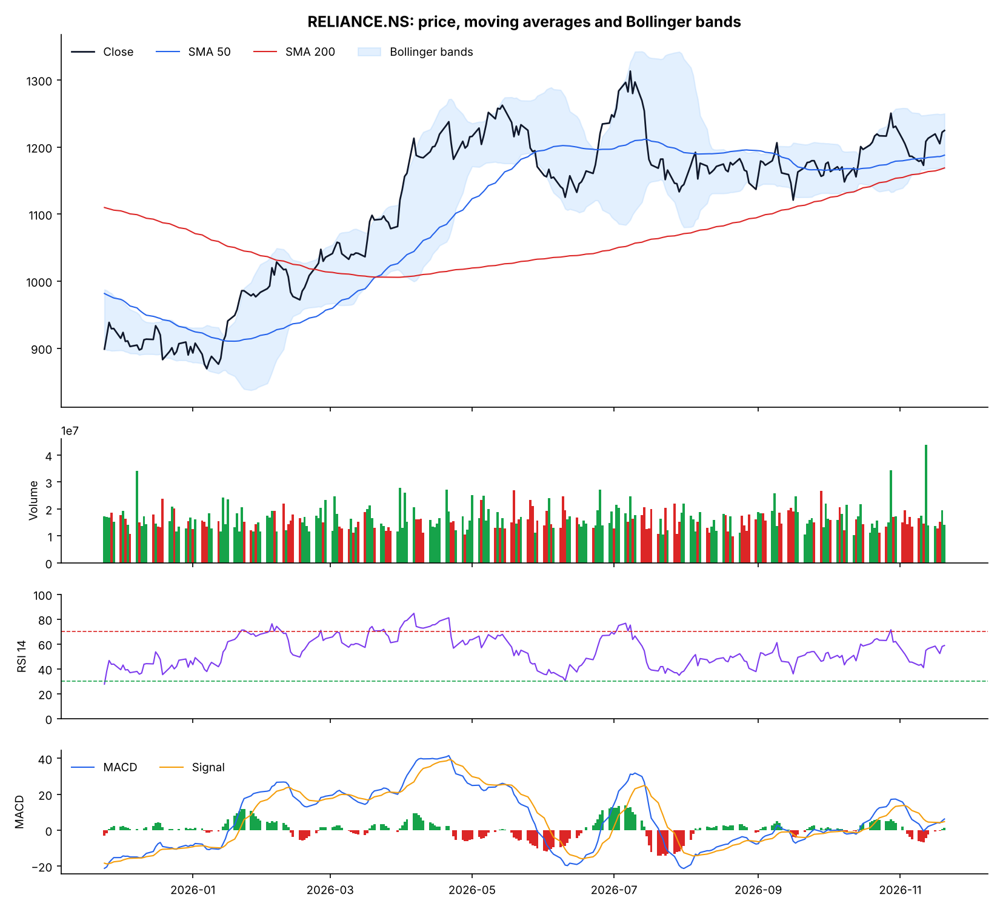
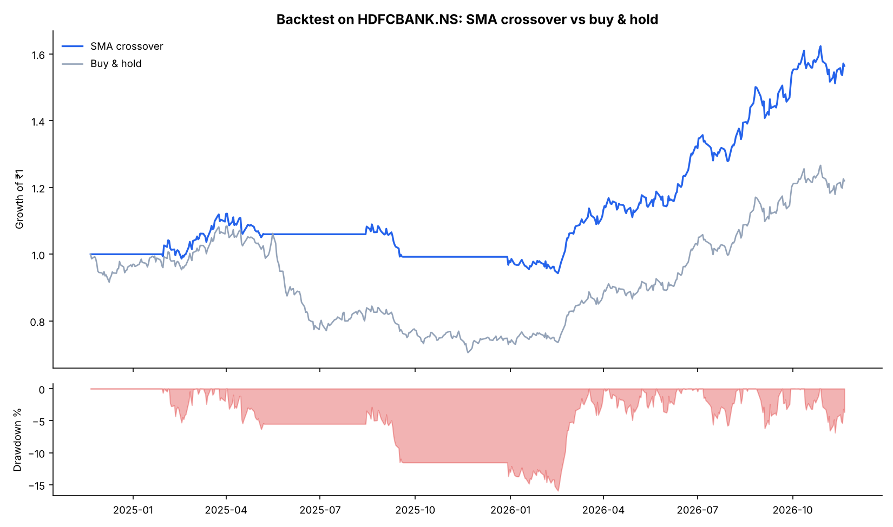
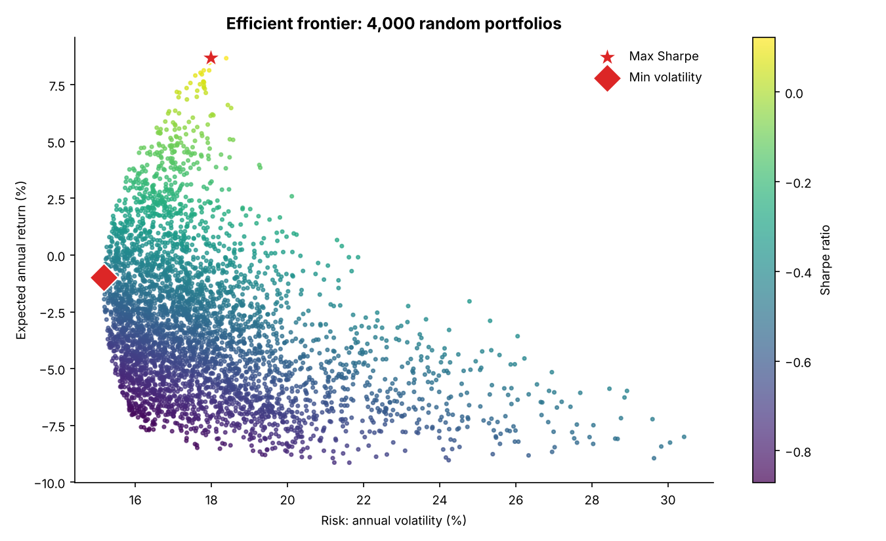
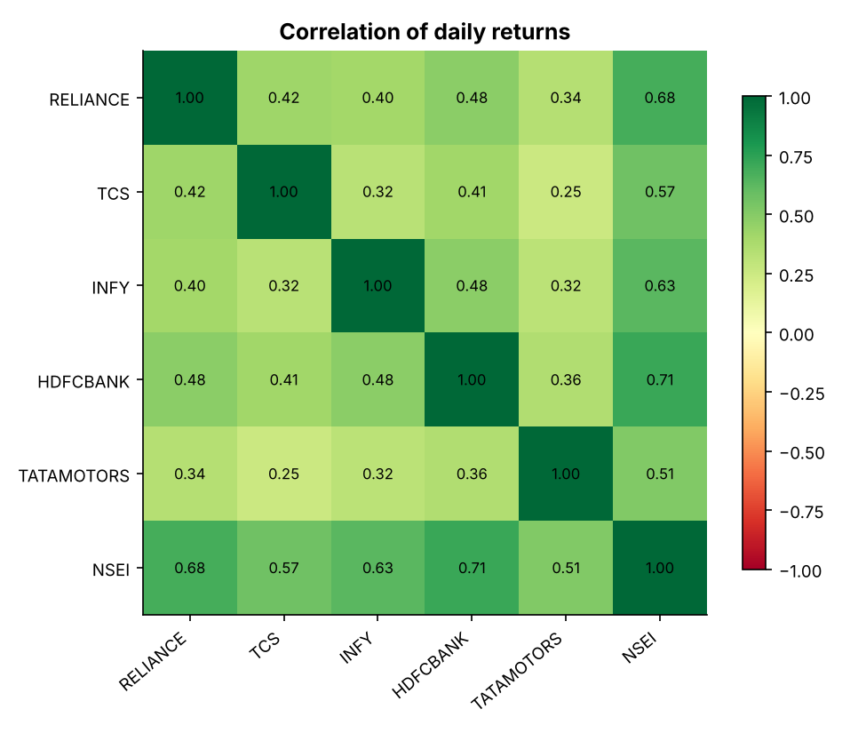

# Stock Market Data Analyzer

A quantitative stock-analysis toolkit in Python. It downloads price history from **Yahoo Finance**, calculates
**technical indicators** and **risk metrics**, compares stocks against the **NIFTY 50**, **backtests trading
strategies**, and finds optimal portfolios with **Modern Portfolio Theory**. Everything is shown in a dark,
trading-style **Streamlit** dashboard with candlestick charts.



> ⚠️ Educational project, not investment advice. The screenshots and sample outputs in this repository were
> made with bundled **simulated** prices (the build machine was offline). On a computer with internet access,
> the same commands use **real** Yahoo Finance data automatically.

---

## Problem statement

Raw price charts don't tell an investor how risky a stock is, whether it moves with the market, or whether a
trading idea would have worked. Answering those questions takes data cleaning, indicators, statistics,
backtesting and portfolio maths. This project packages them into one tool with clear visuals.

## Industry relevance

Brokers (Zerodha, Groww), research platforms (TradingView, Screener.in, Bloomberg), mutual funds and risk teams
use exactly these calculations every day. The project covers **time-series analysis, financial statistics,
backtesting methodology, optimisation and visualisation**, which suits **Data Analyst, Quant/Risk Analyst,
FinTech and Python Developer** roles.

## Features

- **Data**: any Yahoo Finance ticker (`RELIANCE.NS`, `AAPL`, `^NSEI`…), cached locally, with an offline fallback
- **Technical indicators written from scratch**: SMA 20/50/200, EMA, RSI (Wilder), MACD, Bollinger Bands, ATR, OBV
- **Risk & return**: total return, CAGR, volatility, Sharpe, Sortino, max drawdown, VaR 95%, best/worst day, beta and alpha vs NIFTY 50
- **Signal panel**: trend, golden/death cross, RSI, MACD, Bollinger, plus an overall view
- **Backtester**: SMA crossover, RSI mean reversion, MACD momentum; next-day execution (no look-ahead), transaction costs, trade list, win rate, drawdown
- **Portfolio optimiser**: 4,000 Monte Carlo portfolios, efficient frontier, max-Sharpe and min-volatility weights
- **Comparison**: growth of ₹100, correlation heatmap, risk-vs-return scatter
- **Dashboard**: candlesticks with overlays, volume, RSI and MACD panels, monthly-returns heatmap, interactive strategy parameters
- **Excel report** with native chart, plus PNG charts
- **14 automated tests**, including a look-ahead-bias test

## Tech stack

| Area | Tools |
|---|---|
| Language | Python 3.10+ |
| Data | yfinance, Pandas, NumPy |
| Visualisation | Plotly (interactive), Matplotlib (static) |
| Dashboard | Streamlit (dark theme) |
| Reports | XlsxWriter |
| CLI | argparse, Rich |
| Testing | pytest |

## How it works

```
ticker(s) → Yahoo Finance / cache / sample → clean → indicators → risk & return metrics
   → signals → backtests → portfolio optimisation → dashboard · charts · Excel
```

Formulas and design decisions: [docs/PROJECT_EXPLANATION.md](docs/PROJECT_EXPLANATION.md)

## Folder structure

```
Stock-Market-Data-Analyzer/
├── data/                     # offline sample prices (simulated) for NIFTY 50 + 5 stocks
├── src/
│   ├── data_loader.py        # yfinance download, cache, clean, sample fallback
│   ├── indicators.py         # SMA, EMA, RSI, MACD, Bollinger, ATR, OBV
│   ├── analysis.py           # CAGR, volatility, Sharpe, Sortino, drawdown, VaR, beta/alpha
│   ├── signals.py            # indicator verdicts and crossovers
│   ├── backtest.py           # strategy backtester
│   ├── portfolio.py          # Markowitz Monte Carlo optimiser
│   ├── charts.py             # Matplotlib charts
│   └── report.py             # Excel report
├── scripts/
│   └── generate_sample_data.py
├── outputs/                  # sample Excel reports and comparison CSV
├── images/                   # charts and dashboard screenshots
├── docs/                     # project explanation, interview Q&A
├── tests/test_analyzer.py
├── main.py                   # command-line tool
├── app.py                    # Streamlit dashboard
├── requirements.txt
└── .gitignore
```

## Installation

```bash
git clone https://github.com/rohitsingh83/Stock-Market-Data-Analyzer.git
cd Stock-Market-Data-Analyzer
```

Create and activate a virtual environment.

On Windows:

```bash
python -m venv venv
venv\Scripts\activate
```

On macOS or Linux:

```bash
python3 -m venv venv
source venv/bin/activate
```

Install the dependencies:

```bash
pip install -r requirements.txt
```

## How to run

Open the dashboard:

```bash
streamlit run app.py
```

Full analysis of one stock (indicators, signals, metrics, backtests, Excel report, charts):

```bash
python main.py analyze RELIANCE.NS
```

Any Yahoo Finance ticker:

```bash
python main.py analyze AAPL
```

Compare the watchlist against the NIFTY 50:

```bash
python main.py compare
```

Backtest one strategy:

```bash
python main.py backtest TCS.NS --strategy "RSI mean reversion"
```

Portfolio optimisation:

```bash
python main.py portfolio
```

Force offline sample data:

```bash
python main.py --source sample analyze RELIANCE.NS
```

Run the tests:

```bash
python -m pytest -q
```

## Sample output

`python main.py --source sample analyze RELIANCE.NS` *(simulated prices)*:

```text
╭──────────────────────── 📈 Stock Market Data Analyzer ─────────────────────────╮
│ RELIANCE.NS  last close 1,224.64 on 20 Nov 2026 · 522 trading days · offline   │
│ SAMPLE data (simulated, not real prices)                                       │
╰────────────────────────────────────────────────────────────────────────────────╯
 Total return  -6.35%   CAGR -3.12%   Volatility 20.99%   Sharpe -0.36
 Max drawdown -34.16%   VaR 95% 2.21%   Beta 1.00   Alpha -10.20%

                Technical signals: Mostly bullish
 Trend (SMA 50/200)      1,225 vs 1,188 / 1,169        Bullish
 Last 50/200 crossover   Golden cross on 23 Mar 2026   Bullish
 RSI (14)                58.7                          Neutral
 MACD                    6.24 vs signal 4.78           Bullish

          Backtests (0.10% cost per trade, next-day execution)
 Metric              SMA crossover   RSI mean reversion   MACD momentum
 Total return               -8.12%               16.36%         -27.94%
 Buy & hold return          -6.35%               -6.35%          -6.35%
 Max drawdown              -22.36%               -7.36%         -33.52%
 Trades                          6                    2              28
```

`python main.py compare`:

```text
 Ticker          Total return     CAGR   Volatility   Sharpe   Max drawdown   Beta
 HDFCBANK.NS           22.00%   10.07%       19.51%     0.26        -34.95%   0.97
 RELIANCE.NS           -6.35%   -3.12%       20.99%    -0.36        -34.16%   1.00
 TATAMOTORS.NS        -27.30%  -14.27%       34.64%    -0.46        -65.46%   1.24
 INFY.NS              -22.21%  -11.42%       23.11%    -0.69        -51.74%   1.01
 TCS.NS               -16.59%   -8.38%       18.66%    -0.73        -25.19%   0.74
```

Files: [`outputs/RELIANCE_analysis.xlsx`](outputs/RELIANCE_analysis.xlsx) ·
[`outputs/HDFCBANK_analysis.xlsx`](outputs/HDFCBANK_analysis.xlsx) ·
[`outputs/watchlist_comparison.csv`](outputs/watchlist_comparison.csv)

## Screenshots

| Backtest | Portfolio optimizer |
|---|---|
|  |  |

| Risk & return | Compare |
|---|---|
|  |  |

Static charts:

| | |
|---|---|
|  |  |
|  |  |

## Learning outcomes

- Fetching, caching and cleaning financial time series
- Implementing technical indicators from their mathematical definitions
- Financial statistics: annualisation, Sharpe, Sortino, drawdown, VaR, CAPM beta and alpha
- Designing honest backtests: no look-ahead bias, transaction costs, benchmarks
- Modern Portfolio Theory and Monte Carlo simulation
- Professional financial charts with Plotly (candlesticks, subplots, range breaks)
- Building a multi-tab analytical dashboard and testing numerical code

## Interview preparation

13 common questions with HR and technical answers, starting with **"Explain your project"**:
[docs/INTERVIEW_QA.md](docs/INTERVIEW_QA.md)

## Disclaimer

This project is for learning only. It does not give investment advice. Bundled sample prices are simulated and
do not represent real market history.
